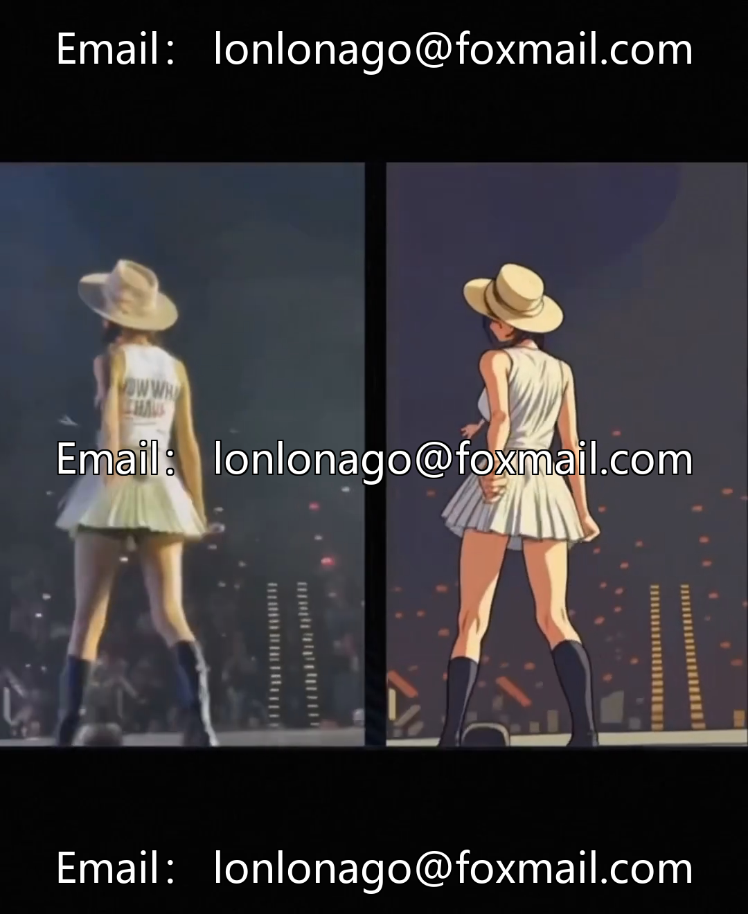

# Video Convert to Cartoon Toolkit - 3 Software Collection, Multi-Anime Style, Low Configuration Compatibility

## Body

Video Convert to Cartoon Toolkit - 3 Software Collection, Multi-Anime Style, Low Configuration Compatibility

Product highlights

No need for high-configuration computers or complex AI model operations, even beginners can easily get started. One-click video conversion to anime style, with nearly two hundred cartoon effect templates built-in, offering a variety of styles to choose from, suitable for short video creation, material styled, and other creative needs.

Toolkit details

Contains 3 tools of the same series, with similar operation interface logic. The number and style of built-in effect templates vary, suitable for different creative needs.

Run and Output Specifications

• System Support: Only supports Windows system.

• Hardware requirements: There is no mandatory requirement for an independent graphics card. The main dependence on the CPU and RAM, with a built-in graphics card can improve processing speed.

• Output format: Supports common video formats such as mp4, avi, flv, mov.

• Resolution range: Covers 480p, 720p, 1080p, 2K, 1440p, and 4K with multiple options available.

• Duration of conversion: The longest support for a single video segment is 300 seconds.

• Processing speed: The conversion duration varies depending on the selected effect model, output resolution, and computer configuration.

Shipping and Instructions

1. After payment and receipt of goods, send the resource download link via cloud storage. If you have any objections, please proceed with caution.

2. This product is a digital resource organized by the individual, and it is copyable. After shipping, non-file damage issues are not supported. Please confirm your needs before placing an order.

3. The fee is for the service of resource collection and organization, and the software functions and effects are to be explored by oneself.

4. Please use the tool in compliance with regulations and relevant laws, and do not use it for illegal purposes such as copyright infringement.

## Images

## Payment

Here is a pay link on Stripe ( https://buy.stripe.com/3cs8yP7sY87d0vu9AB ). Please contact me lonlonago@foxmail.com after funding $89, and I will send you a complete data files , thank you!

